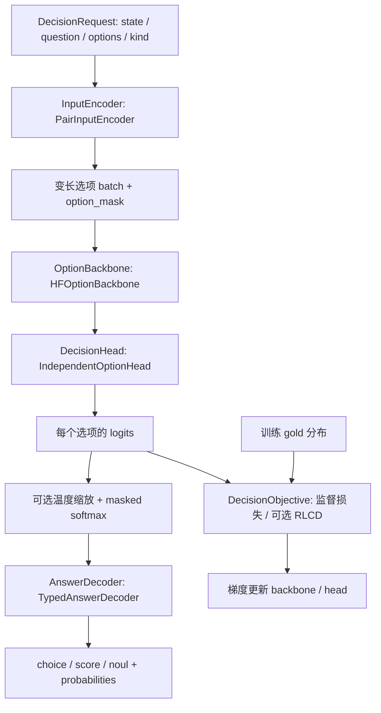

# 项目架构：独立微调任务与自研 Decision Model

本项目提供七条独立的模型训练与推理路径：Embedding、Ranker、Decision、LLM Base、LLM Instruct、LLM PPO 和 LLM GRPO。
每条路径拥有自己的配置、数据校验、采样、损失、优化器、评估、训练组装、导出和 CLI。
七类任务可以分别训练、部署和调整，应用层按需要组合它们。

Decision 的定位是本项目自行实现的决策模型。Laya 仅作为思想参考：将问题与候选选项显式建模，
输出可解释的类型化概率，并关注概率校准。输入编码、模型组合、决策 head、损失、奖励、
训练、校准、解码及导出均由本项目实现；运行和安装不依赖 Laya。
基础文本表示复用可配置的 Hugging Face 预训练 encoder，决策 head 从随机参数开始训练。
这是在预训练语言表示上训练自己的决策模型，业务决策能力需要通过领域数据验证。

## 1. 模型任务并行，应用组合单独表达

Embedding、Ranker、Decision、LLM Base、LLM Instruct、LLM PPO、LLM GRPO 是同一级的任务模块，各自从数据到训练、评估、导出、推理形成闭环。
图中的并行表示独立且同级，不表示必须同时训练。它们可以分别选择基座、参数、设备和部署方式。

```mermaid
flowchart TB
    subgraph TASKS[七条独立模型路径]
        direction LR
        subgraph EMB[Embedding]
            direction TB
            ED[文本与对比学习样本] --> ET[独立训练]
            ET --> EV[检索评估与选模]
            EV --> EX[模型导出]
            EX --> EI[推理：文本 → 向量]
            EX --> EH[可选 Hub 发布]
            EH --> EI
        end
        subgraph RNK[Ranker]
            direction TB
            RD[文本对、标签与评估候选] --> RT[独立训练]
            RT --> RV[排序评估与选模]
            RV --> RX[模型导出]
            RX --> RI[推理：文本对 → 分数]
            RX --> RH[可选 Hub 发布]
            RH --> RI
        end
        subgraph DEC[Decision]
            direction TB
            DD[状态、问题、选项与标签] --> DT[独立训练]
            DT --> DV[决策评估、选模与可选校准]
            DV --> DX[模型导出]
            DX --> DI[推理：决策请求 → 概率与答案]
            DX --> DH[可选 Hub 发布]
            DH --> DI
        end
        subgraph BASE[LLM Base]
            direction TB
            BD[文档文本] --> BT[继续预训练]
            BT --> BV[validation NLL 选模]
            BV --> BX[full / adapter 导出]
            BX --> BI[推理：generate]
            BX --> BH[可选 Hub 发布]
            BH --> BI
        end
        subgraph INST[LLM Instruct]
            direction TB
            ID[指令与对话] --> IT[助手回复 SFT]
            IT --> IV[validation NLL 选模]
            IV --> IX[full / adapter 导出]
            IX --> II[推理：chat]
            IX --> IH[可选 Hub 发布]
            IH --> II
        end
        subgraph PPO[LLM PPO]
            direction TB
            PD[问题与奖励参考] --> PT[在线采样与 PPO 更新]
            PT --> PV[validation reward 选模]
            PV --> PX[actor 与价值头导出]
            PX --> PI[推理：generate / chat]
            PX --> PH[可选 Hub 发布]
            PH --> PI
        end
        subgraph GRPO[LLM GRPO]
            direction TB
            GD[问题与奖励参考] --> GT[组内采样与 GRPO 更新]
            GT --> GV[validation reward 选模]
            GV --> GX[actor 导出]
            GX --> GI[推理：generate / chat]
            GX --> GH[可选 Hub 发布]
            GH --> GI
        end
    end
```



七条路径各自使用中立的配置/运行/checkpoint/产物/来源追踪工具。
依赖方向为任务模块 → `common`；七个任务不互相导入。
四个 LLM 任务另复用 `llm/` 下的 SDK、运行参数、配置校验与文件读取工具，损失、指标、选模和训练组装归各任务。
当前 Decision 使用自己的训练循环，Embedding/Ranker 使用共享检索训练循环；
Base/Instruct 各自组装 Transformers Trainer，PPO/GRPO 各自实现在线 RL 训练循环。训练器差异不意味着模型任务存在上下游关系。
Base full/merged 导出可作为 Instruct 的初始模型，SFT full/merged 导出可作为 PPO/GRPO 的初始模型；这些都是可选的产物衔接，不是模块依赖。

离线准备及应用组合属于另一个层次，因此不放进主模型图：

| 可选组件 | 可以使用的模型能力 | 关系 |
|---|---|---|
| `data_preparation` | Embedding 挖掘负例，或已标注/人工/关键词候选 | 产出标准训练数据，训练器不隐式挖掘 |
| `workflows` | Embedding 召回 + Ranker 重排 | 显式组合两种推理能力用于检索评估 |
| 业务应用 | 任意模型的输出可作为业务数据 | 可构造 Decision state，也可独立使用 Decision；当前检索 workflow 不实现这一步 |

### 1.1 统一职责、契约与生命周期

统一目标是：七条任务提供相同的工程入口、职责划分与实验阶段，每类任务保留自己的请求、
batch、loss、指标和输出语义。现有代码尚未全部达到这个目标。

```text
各任务 config + data
        ↓
模型加载 → baseline 评估 → 训练 → validation 选模
        ↓
可选 postprocess 拟合 → test 评估 → export
        ↓
Model.load → predict(任务请求) → 任务结果
或：export → 显式 publish → Hub snapshot → Model.load → 任务结果
```

Postprocess 是可选阶段：Decision 可以拟合温度；当前 Embedding/Ranker 没有拟合步骤。
实际指标和 batch 形状由任务实现，不要求不同任务采用相同张量或同一个损失。
下表对比 Embedding/Ranker/Decision 的现有入口；LLM Base/Instruct 的对应实现见第 8 节，PPO/GRPO 见第 9 节。

| 统一维度 | 当前代码差异 | 统一目标 | 保留的任务语义 |
|---|---|---|---|
| 模型 | 三类均有 `model.py` 和任务自己的 `backbones.py/heads.py`；组件实现与张量语义不同 | `model.py` 负责模型组合、加载、保存和公开推理；网络组件按任务复杂度拆分 | 文本向量编码、cross-encoder 相关性、类型化选项决策 |
| 配置 | Embedding/Ranker 复用配置基类；Decision 使用自己的 dataclass/校验 | 一致的配置分区与中立校验工具，任务局部扩展 | Prefix/pooling、候选配置、head/选项预算/校准配置 |
| 评估 | 三类入口均返回 `(metrics, predictions)`，已有统一指标记录；整体实验报告字段仍不同 | `evaluate.py` 统一编排，`metrics.py` 管指标，返回一致的报告外壳 | Recall/MRR/nDCG 与 NLL/Brier/ECE/有序误差 |
| 推理 | 三类公开推理均在 `model.py`；Embedding 用 `encode`，Ranker 用 `score`，Decision 用 `system_one` | 对齐模型生命周期契约，保留各任务的推理语义方法 | 向量、原始相关性 logits、校准概率/类型化答案 |
| 生命周期 | `run(cfg)` 与 `run_experiment(config_path)` 不同，report 字段也不同 | 任务自己的 `pipeline.py` 使用相同阶段契约、选模策略与结果字段 | 采样、loss、batch 和可选校准流程分别实现 |

这里的统一不要求更换 Sentence Transformers，也不要求三类模型复用同一份 encoder 权重。
各任务在自己的 `model.py` 中适配加载后端，不依靠其他任务的模块，也不要求单独的 provider 层。

目标公共契约可以按任务请求/结果类型参数化：

```text
Model.load(path, device) -> 任务模型门面
Model.save(path) -> 导出路径
Model.predict(requests, batch_size) -> 任务结果
Evaluator.evaluate(...) -> EvaluationResult(metrics, predictions, metadata)
Pipeline.run(config, resume) -> ExperimentReport
```

`ExperimentReport` 的共同字段建议为 `task`、`data`、`training`、`baseline`、`selected`、
`postprocessed`、`export_dir`、`runtime`；不适用的 postprocessed 明确为 null。
Metrics 使用任务自己的字段名及选模方向，不能把 ranker 原始 logit 解释成已校准概率。
请求/结果结构和导出 manifest 必须带任务身份与 schema 版本；旧 SDK/原生权重文件继续由各任务的 `model.py`
负责读写，统一外层 manifest 不意味着强制转换其内部权重格式。

以上为接口与报告的**目标设计**，当前没有全局 `Model` 类或统一 `EvaluationResult`。
下文的 Decision 组件以及第 2 节的当前目录描述现有已实现代码。

## 2. 目录与修改边界

```text
configs/
  embedding/ ranker/ decision/     # 分别配置模型、数据、训练、运行、评估
  data_preparation/ workflows/     # 可选准备与组合评估配置
src/advai_notebooks/
  common/                         # 运行设备、原子产物、checkpoint、来源指纹、训练执行等
    hub.py                        # 中立发布打包/Hub 上传/snapshot 下载
  embedding/
    backbones.py                  # 文本编码组件，引用原生 Transformer
    heads.py                      # Pooling、可学习输出层、Normalize，保留原模块顺序
    model.py                      # 网络组合、加载/保存、输入处理、encode
    config.py data.py sampling.py losses.py optimizer.py train.py
    metrics.py evaluate.py pipeline.py cli.py
    publish.py                    # Embedding 文件契约、模型卡与发布入口
  ranker/
    backbones.py                  # 文本对 encoder 视图、原生分类前向路径
    heads.py                      # 分类侧模块视图、单个原始相关性 logit
    model.py                      # 网络组合、加载/保存、输入处理、score
    config.py data.py sampling.py losses.py optimizer.py train.py
    metrics.py evaluate.py pipeline.py cli.py
    publish.py                    # Ranker 文件契约、模型卡与发布入口
  decision/
    contracts.py                  # 请求、编码结果和组件接口
    schema.py                     # 任务定义、硬/软标签校验
    data.py                       # 数据/请求入口、任务校验与有标签训练样本
    encoding.py                   # state 与问题/选项配对编码
    backbones.py                  # HF encoder 与 pooling
    heads.py                      # 独立选项评分 head
    model.py                      # 初始化、加载/保存、输入特征、system_one、网络组合
    losses.py                     # CE、有序监督损失、可选 RLCD
    decoding.py                   # 类型化概率结果解释
    runtime.py                    # 变长选项 batch / forward
    sampling.py optimizer.py      # 任务自己的采样与参数分组
    train.py                      # Decision 训练循环与 epoch 恢复
    evaluate.py metrics.py        # 评估/校准编排、按类型/问题分组指标
    calibrate.py                  # 独立温度校准
    inference.py                  # 原有推理函数的兼容转发入口
    config.py pipeline.py cli.py  # 配置、完整生命周期、命令行
    publish.py                    # 原生 Decision 文件契约、模型卡与发布入口
  llm/
    configuration.py native.py runtime.py records.py  # 中立 SDK / 运行 / 文件工具
    rollout.py rl_runtime.py                         # 采样机械操作、RL checkpoint/RNG
    base/
      config.py backbones.py heads.py model.py         # 模型门面：generate
      data.py sampling.py losses.py optimizer.py       # 文档 CLM
      train.py evaluate.py metrics.py pipeline.py cli.py publish.py
    instruct/
      config.py backbones.py heads.py model.py         # 模型门面：chat
      data.py sampling.py losses.py optimizer.py       # 助手回复 SFT
      train.py evaluate.py metrics.py pipeline.py cli.py publish.py
    ppo/ grpo/                                       # 同级独立 RL 任务
      config.py backbones.py heads.py model.py         # 模型门面：generate/chat
      data.py sampling.py reward.py losses.py optimizer.py
      train.py evaluate.py metrics.py pipeline.py cli.py publish.py
  data_preparation/ workflows/     # 可选组合层
notebooks/                        # 调用同一套 Python 实现的可运行示例
tests/                           # 组件、生命周期及任务独立性验证
```

PPO/GRPO 的目录同样位于 `src/advai_notebooks/llm/`，各自包含
`config.py backbones.py heads.py model.py data.py sampling.py reward.py losses.py optimizer.py train.py
metrics.py evaluate.py pipeline.py cli.py publish.py`。配置在 `configs/llm/{ppo,grpo}/`。

### 2.1 当前职责位置

同一职责可能已被拆成多个内部文件，因此不以文件数量衡量架构是否统一。
模型配置、模型定义、加载/保存、评估、指标、推理应分别列出：

| 职责 | Embedding 当前入口 | Ranker 当前入口 | Decision 当前入口 | LLM Base 当前入口 | LLM Instruct 当前入口 | LLM PPO 当前入口 | LLM GRPO 当前入口 |
|---|---|---|---|---|---| --- | --- |
| 配置 | `config.py` | `config.py` | `config.py` | `config.py` | `config.py` | `config.py` | `config.py` |
| 模型门面/组合 | `model.py` | `model.py` | `model.py` | `model.py` | `model.py` | `model.py` | `model.py` |
| 网络组件 | `backbones.py`, `heads.py` | `backbones.py`, `heads.py` | `backbones.py`, `heads.py` | `backbones.py`, `heads.py` | `backbones.py`, `heads.py` | `backbones.py`、`heads.py`（含价值头） | `backbones.py`、`heads.py` |
| 加载与原生导出入口 | `model.py` | `model.py` | `model.py` | `model.py` | `model.py` | `model.py` | `model.py` |
| 数据与输入入口 | `data.py`，`model.py` 的 prefix/features | `data.py`，`model.py` 的 pair/features | `data.py`，`model.py` 的 prepare/features | `data.py`，`model.py` 的 `prepare` | `data.py`，`model.py` 的 `prepare` | `data.py`、`model.py` 的 prepare | `data.py`、`model.py` 的 prepare |
| 采样 | `sampling.py` | `sampling.py` | `sampling.py` | `sampling.py` | `sampling.py` | `sampling.py`：每问题一条 completion | `sampling.py`：每问题 G 条 completion |
| 损失 | `losses.py` | `losses.py` | `losses.py` | `losses.py` | `losses.py` | `losses.py`：GAE、policy/value clipping | `losses.py`：组内 advantage、clipping/KL |
| 优化器 | `optimizer.py` | `optimizer.py` | `optimizer.py` | `optimizer.py` | `optimizer.py` | `optimizer.py` | `optimizer.py` |
| 训练组装 | `train.py` | `train.py` | `train.py` | `train.py` | `train.py` | `train.py` | `train.py` |
| 评估编排 | `evaluate.py` | `evaluate.py` | `evaluate.py` | `evaluate.py` | `evaluate.py` | `evaluate.py` | `evaluate.py` |
| 指标入口 | `metrics.py` | `metrics.py` | `metrics.py` | `metrics.py` | `metrics.py` | `metrics.py` | `metrics.py` |
| 推理入口 | `model.py` 的 `encode` | `model.py` 的 `score` | `model.py` 的 `system_one` | `model.py` 的 `generate` | `model.py` 的 `chat` | `model.py` 的 generate/chat | `model.py` 的 generate/chat |
| 可选后处理 | 当前无拟合步骤 | 当前无拟合步骤 | `calibrate.py` | 当前无拟合步骤 | 当前无拟合步骤 | 无拟合步骤 | 无拟合步骤 |
| 生命周期与 CLI | `pipeline.py`, `cli.py` | `pipeline.py`, `cli.py` | `pipeline.py`, `cli.py` | `pipeline.py`, `cli.py` | `pipeline.py`, `cli.py` | `pipeline.py`、`cli.py` | `pipeline.py`、`cli.py` |
| 可选 Hub 发布 | `publish.py`, `cli.py` | `publish.py`, `cli.py` | `publish.py`, `cli.py` | `publish.py`, `cli.py` | `publish.py`, `cli.py` | `publish.py`、`cli.py` | `publish.py`、`cli.py` |

表中路径相对各自任务目录；LLM 四列分别对应 `llm/base/`、`llm/instruct/`、`llm/ppo/`、`llm/grpo/`。
这张表列职责入口，网络组件单列；内部实现细节在目录树和下文说明。
七个任务各自维护 `metrics.py`，不共享指标实现。

Base 的 `data.py` 负责文档分组、EOS 与保留边界目标的切片；Instruct 的 `data.py` 负责对话校验、
chat template 与助手回复掩码。两者的 `train.py` 分别组装 Trainer、采样、loss、optimizer 和验证选模回调。
`model.py` 提供公开加载/保存/推理入口，底层 SDK 操作复用 `llm/native.py`；中立配置、运行与文件工具
分别位于 `llm/configuration.py`、`llm/runtime.py`、`llm/records.py`。两任务不互相导入。
Full、adapter 和 merged 是导出方式；`model.save(..., merged=True)` 不属于校准或后处理拟合阶段。

Decision 的红色差异已按当前 Embedding/Ranker 边界对齐：

- `DecisionModel.load/save/from_config` 在 `model.py` 中完整实现初始化、加载和导出，无独立 provider 或 Bundle 包装层。
- `data.py` 暴露请求类型、任务/记录校验和训练样本组装；`model.prepare/features/check_lengths` 负责输入处理。
- `evaluate.py` 提供 `evaluate`、`fit_postprocess`、`evaluate_selected`，统一预测/指标/校准编排；pipeline 只调用并保存产物。
- `DecisionModel.system_one` 是统一无标签推理入口，支持 state + task 或请求列表；旧 predict 系列方法委托给它。encoding/decoding 仍是可替换内部组件。

`DecisionModel` 同时是原生 PyTorch 模块，`.model` 暴露其训练模块，保持 SDK 适配器风格。
直接构造 backbone/head 仍支持网络实验；完整输入/导出/推理需要通过 `from_config` 或 `load` 绑定 tokenizer 与元数据。
旧 provider 模块及 Bundle 包装已移除，调用方直接使用 `DecisionModel`；`inference.py` 保留函数式推理兼容入口。原生权重命名/schema 和概率语义保持兼容。
Embedding、Ranker、Decision、Base/Instruct 已有共同的指标记录规范；PPO/GRPO 当前返回任务身份、split、指标及预测，未接入该指标记录类型；完整评估类型、实验报告/配置仍未完全统一，以下目标结构继续作为后续约定。

### 2.1.1 网络组件的统一边界

七个任务均通过各自 `backbones.py` 和 `heads.py` 提供组件或原生组件视图，`model.py` 负责加载基础模型、
组合组件、保存/重载以及公开推理。调用第三方库不会改变这个职责划分，组件不跨任务共享。

| 组件 | Embedding | Ranker | Decision | LLM Base | LLM Instruct |
| --- | --- | --- | --- | --- | --- |
| Backbone | 原生 Transformer 组件及 HF encoder | 原生文本对 encoder 和 HF 分类模型的前向适配 | HF encoder 与选项级 pooling | 原生 causal decoder 视图 | 原生 causal decoder 视图 |
| Head | 一个 Pooling、原有 Dense 等输出模块、末尾 Normalize | 分类侧模块视图及单个相关性 logit 的输出规则 | 类型 embedding 与独立选项评分 MLP | 原生 LM head 词表投影视图 | 原生 LM head 词表投影视图 |
| 输出 | 单个归一化向量 | 单个原始相关性 logit | 选项 logits，供类型化概率解码 | token logits；推理返回续写列表 | token logits；推理返回助手回复字符串 |

Embedding 的组件视图直接引用 SentenceTransformer 中的原有模块；推理按 backbone → head
执行，head 保留完整输出模块顺序。MNRL/cached MNRL 仍使用同一个 SentenceTransformer 网络，
两条路径使用同一组参数。Pooling 和 Normalize 可以不含可学习参数；原有 Dense 层继续保留。

Ranker 的组件视图引用 CrossEncoder 的原有 HF 模型。`model.backbone` 暴露纯 encoder，
`model.head.modules` 暴露分类侧模块（例如 dropout/classifier）。评分仍经过该架构的原生完整
分类 forward，再提取单个 logit，以保留 BERT 的 pooler/dropout/classifier 顺序和 RoBERTa
等架构的分类头语义。这是组件调整入口，当前未将任意 HF 分类网络重写成通用的独立 head forward。

这两个任务的组件封装不重复注册参数；参数仍由原生库模型持有，保存沿用原模块名称与格式。
Decision 的组件由自己的 PyTorch 网络持有。职责与文件布局统一，组件的继承类型、调用签名、
张量形状和参数注册方式仍按任务保留。后续新增可学习组件需同时实现配置与导出重载支持。

Base/Instruct 的组件视图直接引用各自原生 CausalLM 中的 decoder 和 LM head，forward 仍由原生模型执行，
保留因果注意力、架构行为与权重绑定，不重复注册参数，也不另外构建分类 head。
两者的训练差异由数据与损失实现表达：Base 监督有效文本的下一 token，Instruct 仅监督助手回复区域。

### 2.2 目标目录：三类任务采用相同骨架

以下为待实施的统一目录约定，不代表这些文件均已存在。

```text
src/advai_notebooks/
  common/
    contracts.py                   # 中立模型/评估/实验契约，不导入任务模型
    configuration.py               # 中立配置加载、公共字段及校验
    runtime.py checkpoint.py       # 设备/AMP、恢复
    artifacts.py provenance.py     # 产物/来源追踪
  embedding/                       # 采用下述 task 骨架
  ranker/                          # 采用下述 task 骨架
  decision/                        # 采用下述 task 骨架

每个 task/
  config.py                        # 公共配置 + 任务局部字段
  contracts.py                     # 任务请求/结果/训练样本
  data.py encoding.py              # 数据校验、输入处理
  model.py                         # 模型组合、初始化、load/save、输入处理与公开推理
  backbones.py heads.py             # 任务自己的编码组件与输出组件
  sampling.py losses.py optimizer.py
  train.py                         # 任务训练组装
  inference.py                     # 可选内部推理实现或旧 API 的兼容层
  metrics.py evaluate.py           # 指标与评估编排分开
  postprocess.py                   # 可选拟合/后处理，未启用时 identity
  pipeline.py cli.py               # 相同生命周期阶段与命令约定
```

骨架规定职责边界；任务确有复杂度时可继续拆文件，例如 Decision 的 `schema.py`、`decoding.py`、
`calibrate.py` 可以保留为内部实现。Embedding 的 head 可以是 pooling/normalization，
不必增加可学习分类 head。实现为 identity 的可选阶段也无需生成空模块。加载与保存实现归 `model.py`，无需为此建立 provider 目录。

公共配置应提取任务中立字段，不应让 Decision 继承 corpus/qrels/query-prefix 必填规则。
当前 `common/configuration.py` 的 `BenchmarkDataConfig` 及 `validate_common` 含检索数据假设，
需要先区分通用实验校验与检索校验，再由各任务扩展。学习率可以通过任务拥有的 optimizer
参数分组表示，不强迫 Decision 放弃 encoder/head 独立学习率。

Embedding/Ranker 当前共享优化循环，接受模型适配器、epoch batch 生成器、batch loss、评估函数和
任务 optimizer 工厂；Decision 当前使用自己的循环。统一目标先对齐阶段契约、选模/checkpoint 行为，
再判断哪些执行逻辑值得提取到中立循环。变长选项及可选校准不妨碍共同生命周期，
也不要求立即合并所有训练内部实现。

### 2.3 实施顺序与兼容约束

1. 定义中立 `ModelAdapter`、`EvaluationResult`、`ExperimentReport` 契约，拆清公共与任务配置校验。
2. 三类任务对齐模型门面、推理入口和评估报告；保留旧 `encode/score/predict_requests` 调用。
3. 各任务将初始化、加载和保存放在 `model.py`，按需要拆出网络/encoding/metrics；迁移 CLI/Notebook/workflow 调用，避免通过旧位置形成反向依赖。
4. 对齐 baseline/validation/postprocess/test/export 生命周期与输出 manifest，再提取重复执行逻辑。

每步均以原导出重载、预测数值一致、依赖隔离和中断恢复测试为边界。
职责迁移会改变源码指纹，旧训练状态不能跨实现严格续训；旧推理导出需继续由兼容加载器读取。
Decision 的公开职责入口已在代码中对齐；全项目的公共类型、配置、报告及目录迁移仍待按以上步骤实施。

### 2.4 指标：任务独立实现，保持一致的记录格式

```text
embedding/evaluate.py → embedding/metrics.py   检索指标、记录校验、选模规则
ranker/evaluate.py    → ranker/metrics.py      重排指标、记录校验、选模规则
decision/evaluate.py  → decision/metrics.py    决策指标、记录校验、选模规则

embedding/train.py ─┐
                    ├→ common/retrieval_training.py  接收任务传入的选模回调
ranker/train.py ─────┘
decision/train.py      调用本任务的选模函数
```

每个任务的 `metrics.py` 完整拥有公式、记录构造/校验、指标选择和最优值比较。
三个任务之间没有 metrics 导入依赖，common 不包含指标实现。
Embedding 评估完整语料检索排名，Ranker 评估给定候选的重排结果；两者各自实现
Recall/MRR/nDCG，初始公式一致，后续可分别调整。Recall 分母与 nDCG ideal 均使用完整已知 qrels，
缺失正例继续缺失。Decision 独立实现 NLL/Brier/ECE/Accuracy/等级期望误差。

`metrics.py` 负责指标计算与选模规则，`evaluate.py` 编排预测/分组/评估，`calibrate.py` 拟合温度。
数据准备只校验候选结构、query 覆盖、文档 ID 和有限分数，不计算指标。
组合工作流的检索结果调用 Embedding metrics，重排结果调用 Ranker metrics。

任务指标报告保持一致的 `task`、`metric_schema_version: 1`、`metric_records` 格式：

```json
{
  "name": "recall@10",
  "value": 0.75,
  "n": 2,
  "group": {"scope": "overall"},
  "direction": "maximize"
}
```

示例值仅说明格式，不是项目 benchmark。记录包含名称、数值、统计样本数、分组和优化方向。
`group.scope` 可以是 overall、query、question 或 type；非整体分组附带 `id`。
这是文档约定，各任务独立实现并测试，不依赖共享 Python 模块。

- 排序 overall 的 `n` 为 query 数，per-query 指标为 1。
- Decision 普通指标的 `n` 为决策数，`normalized_score_mae` 的 `n` 仅计 score 决策。
- Recall/MRR/nDCG/Accuracy 为 maximize；NLL/Brier/ECE/等级误差为 minimize。

指标单位和总体定义仍由任务说明，跨任务数值需要在同一业务口径下比较。
当前配置允许的选模指标范围保持原样；方向存在并不意味着该指标自动成为可配置的选模选项。

各任务自己的 `select_metric` 从记录中选出唯一 overall 指标，`is_improvement` 按明确方向比较；
重复/缺失指标或非有限值会报错。Embedding/Ranker 将这两个函数作为回调传入中立训练循环，
循环执行回调并在 checkpoint 中保存方向。Decision 的训练调用自身实现。
训练中方向变化会报错，相同指标值不替换已有最佳权重。

原排序 `metrics/per_query/n_queries` 与 Decision `overall/by_question/by_type` 字段继续提供，
迁移保持公式、旧数值字段及分母不变，现有 Notebook/报告读取方式可继续使用。
完整 `EvaluationResult/ExperimentReport` 仍为后续目标。

## 3. Decision 的输入与组件契约

### 3.1 无标签请求

公开输入为 `DecisionRequest(state, question, options, kind)`：

- `state`：非空文本、JSON 对象或列表，结构化值必须有限且可序列化。
- `question`：非空问题/指令。
- `options`：至少两个 `DecisionOption(key, description)`，key 不重复。
- `kind`：`choice`、`score` 或 `noul`；类型映射为 0、1、2。

`choice` 的 key 是业务标签；`score` 的 key 按顺序为 `"0"…"K-1"`，描述解释等级；
`noul` 固定为 `false, true`。Score 当前只表示等间距、零基整数等级。
`DecisionRequest.from_question` 可将已有任务 JSON 转成同一输入。请求类型可从公开 `data.py` 入口导入；
`contracts.py`、`schema.py` 是可分别修改的内部定义和校验实现。
训练数据额外提供 `gold`，推理请求无需任务文件、任务 ID 或标签。



接口集中在 `contracts.py`，实现分布在各组件文件中。记 B 为决策数、K 为 batch 最大选项数、
L 为最大 token 数、H 为 backbone 特征维数：

| 接口 | 输入 | 输出 / 责任 |
|---|---|---|
| `InputEncoder` | `DecisionRequest` | `EncodedDecision(options, truncated)`；每选项完整 token 特征 |
| `OptionBackbone` | token/attention `[B,K,L]`、option mask `[B,K]`、可选 token types | `[B,K,H]` pooled 特征；暴露 `output_size=H` |
| `DecisionHead` | 特征 `[B,K,H]`、mask `[B,K]`、qtype `[B]` | `[B,K]` logits |
| `DecisionObjective` | logits、gold、mask `[B,K]`，qtype `[B]`，可选 sigma | 按示例平均的标量损失 |
| `AnswerDecoder` | 请求、已校准概率、可选置信度阈值 | 类型化答案字典 |

`DecisionModel` 可以接收自定义 PyTorch backbone/head。当前配置工厂只提供
`model.encoding: pair`、`model.head: independent`、`model.decoder: typed`；未知名字直接报错。
新增组件时需扩展对应工厂和配置校验，并实现导出/重载及形状、mask、梯度测试。
直接注入自定义组件用于代码实验；当前 `DecisionModel.save/load` 仅支持持久化已支持的 HF backbone/独立 head，
尚不提供任意组件的自动序列化。

### 3.2 编码与 baseline 模型

`PairInputEncoder` 将同一 state 与每个完整问题/选项段分别配对：

```text
segment A: state 文本或稳定 JSON
segment B: type + question + option key + criteria description
```

Fast tokenizer 的 post-processing 保留 BERT/RoBERTa 各自特殊 token 约定。
`head_max_len` 限制问题/选项段；`max_len` 限制含特殊 token 的整个 pair。
所有选项使用能容纳最长段的同一 state 前缀，避免选项之间看到的状态内容不同。
超长问题/选项或 token 化后完全相同的选项会报错。
训练默认拒绝 state 截断，显式允许时记录截断数；公开推理入口拒绝截断。

Backbone 只编码有效选项，mean/CLS pooling 后返回特征。独立 head 加入问题类型嵌入，
通过共享 `LayerNorm → Linear → GELU → Dropout → Linear` 输出标量分数。
不存在选项位置嵌入；choice 调换顺序不会改变对应标签的概率，score 的顺序仍定义等级语义。
Padding 不经过 encoder，padding logits 在 loss/softmax 前屏蔽。

当前 head **逐选项独立评分**：一个选项的原始 logit 不读取其他选项的表示，
仅最终 softmax 的分母形成相对比较。Encoder 计算量随有效选项数增长。
跨选项 attention、共享 state 编码或其他交互 head 是后续实验，当前尚未实现。

HF 基座要求双向文本 encoder、`hidden_size`、fast tokenizer 和 pad token。
Decoder-only、seq2seq 模型会被拒绝。`model.pooling`、`head_hidden_size`、`dropout`、
`freeze_encoder` 以及 encoder/head 独立学习率可分别调整。

## 4. Decision 的训练目标与实验定位

默认 `training.loss: supervised`，支持硬标签和软分布 y。对有效选项概率 p：

```text
CE = -Σ_i y_i log(p_i)
Ordinal = Σ_{j=0}^{K-2} (CDF_p(j) - CDF_y(j))² / (K-1)
L_supervised = mean_examples(ce_weight × CE + ordinal_weight × 1[kind=score] × Ordinal)
```

Choice 使用多分类 CE；noul 使用 false/true 的两类 CE；score 使用 CE 加归一化 ranked
probability score。有序项惩罚跨等级更远的概率误差，排除最终 CDF 和 padding。
损失对全部决策示例取平均，非 score 示例的有序项为零，保证不同 microbatch 的累积权重一致。
默认 `ce_weight=1`、`ordinal_weight=1`。这是一套明确可复现的监督基线。

| 模式 | 目标 | 配置 / 用途 |
|---|---|---|
| `ce` | 仅 `ce_weight × CE` | `ce_smoke.yaml`：移除有序项的对照 |
| `supervised` | CE + score 的有序项 | `smoke.yaml` / `hf.yaml`：默认路线 |
| `rlcd` | 监督目标 + `rl_weight × RL` | `rlcd_smoke.yaml`：可选实验 |

RLCD 在 logits 上采样中心化 Gaussian 噪声，以 choice/noul 的负 Brier 和 score 的负有序误差
作为原生 proper scoring reward，通过采样策略 log-density 与 detached advantage 更新参数。
`noise_samples`、`sigma_start/end`、`rl_weight` 可配置。将 `ordinal_weight=0` 可恢复此前
CE + RLCD 的目标组合。它借鉴概率奖励优化的思想，不要求复制 Laya 的 encoder、collator 或奖励实现。
RLCD 是否优于监督基线，需要真实数据实验，当前合成 smoke 不提供这种结论。

比较实验应固定基座及 revision、数据与 split、选项描述、token 预算、训练预算、冻结策略、
seed 和校准策略；分别运行 CE、监督有序目标、RLCD，使用各自输出目录。
正式实验应覆盖多个 seed 并记录延迟、显存与每类任务效果，避免只比较一次整体 accuracy。

## 5. 数据、评估与校准

Embedding/Ranker 的训练配置分别校验：Ranker 没有检索器或对比损失设置；Embedding 的检索
配置只评估自身 encoder。负例挖掘位于 `data_preparation`，组合 top-k 位于 `workflows`。
Prepared JSON 包含 schema、数据指纹、rows 和可选 provenance，也支持 JSONL。
Trainer 仍独立验证来源/split、标签与候选身份。各任务可以使用不同 corpus/query/qrels；
组合检索评估需明确指定一套共同 test corpus/qrels。

Decision 的 JSONL 包含 `id/group_id/split/task/state/gold`。任务 JSON 支持三个类型，
允许只标注部分问题；软标签的正总质量会归一化，未知选项、负值、非有限值或零总质量拒绝。
同一来源 group 或相同 state 不得跨 split。真实业务仍需按来源、时间或语义近重复分组。

Decision 生命周期为：baseline → 训练/validation 选模 → 独立 calibration 拟合 → test 对比 → export。
默认 epoch 0 参与选模，validation 的未校准 NLL/Brier/ECE 最小或 accuracy 最大者获选。
Calibration 启用时需要 train/validation/calibration/test 四个 split；关闭时只需三个。
Test 既不选模型，也不拟合温度。

温度按 calibration NLL 有界拟合，类型样本不足时使用 1，选项数 bucket 不足时回退到类型温度。
拟合将 identity 作为候选，保证 calibration 集 NLL 不回退；测试指标仍可能变差。
关闭校准时导出 identity 温度，报告的 calibrated metrics 为 null。

现有报告包含整体、按 question、按类型的 accuracy/NLL/Brier/ECE，以及 score 的 normalized
expected-level MAE。后续真实评估需补充领域子群、类不平衡、选项数量、拒答覆盖率/错误率、
以及不同来源/时间分布。当前 tiny BERT 与合成数据只验证实现闭环；真实业务 benchmark、
选项交互 head、LoRA 和多 GPU 尚未实现或验证。

## 6. 模型产物如何用于推理

Embedding 使用 `EmbeddingModel.load/encode`，Ranker 使用 `RankerModel.load/score`，
API 与 SDK 原生导出结构保持不变。旧 Ranker 导出中的无关 pooling 字段仍可读取。

三个 `Model.load` 也支持 Hugging Face 仓库 ID、`revision`、`token`、`cache_dir` 和
`local_files_only`。远程 snapshot 下载后仍使用各任务自己的加载器。
发布使用三个相同的 `publish --export-dir ... --repo-id ...` CLI 入口，并保留原生权重结构。
`--dry-run` 离线验证筛选后的推理包；真实上传返回 commit SHA。
任务自己的 `publish.py` 管文件契约和模型卡，`common/hub.py` 管传输，不承担网络组件或指标职责。
训练不自动上传，发布不上传训练数据或优化器状态。详细流程见 [发布指南](publishing.md)。

Decision 原生导出为：

```text
export/
  decision_config.json            # schema v2、架构/组件、预算、pooling/head、温度
  model.safetensors               # 完整 backbone + head 参数
  encoder/config.json            # 重建基座结构
  tokenizer/                     # 相同 token 化约定
  source.json                    # 基座来源 / revision
  tasks.json                     # system_one(state, task=...) 自动使用的定义
  calibration.json               # 校准信息
```

`DecisionModel.load` 从本地配置重建模型并严格加载权重，不必重新下载预训练基座。
`model.system_one` 是推荐的统一推理入口，内部执行编码、forward、温度/softmax 和解码，
推理 batch 不包含 target。

```python
from advai_notebooks.decision.model import DecisionModel

model = DecisionModel.load("outputs/decision/smoke/export", device="cpu")
result = model.system_one("charged twice refund today", task="triage")
# result["answers"][question_id] 是对应问题的类型化答案。
```

State 模式返回 `{"answers": {question_id: answer}}`，自动使用模型携带的任务定义。
`from_config` 绑定任务定义，`save` 写出 `tasks.json`，`load` 自动读回。
也可通过 `tasks=...` 显式指定任务定义；缺少任务定义或未知 task 会报错。
旧导出没有 `tasks.json` 时，仍可显式传定义或直接提交请求。

自定义 state、问题和选项也通过相同入口：

```python
from advai_notebooks.decision.data import DecisionOption, DecisionRequest

request = DecisionRequest(
    state="charged twice refund today",
    question="Which department should handle this ticket?",
    options=(DecisionOption("billing", "Payment or refund"),
             DecisionOption("technical", "Service outage or bug")),
    kind="choice",
)
answer = model.system_one([request])[0]
```

请求列表模式返回同序答案列表，kind 支持 choice、score、noul。
三类输出已实现如下：

| type | 主要返回字段 | 数值语义 |
| --- | --- | --- |
| `choice` | `choice`, `probabilities`, `confidence` | 最大概率的选项 key |
| `score` | `score`, `probabilities`, `confidence`, `level`, `legend` | `score` 为零基等级期望，范围 0…K−1；`level` 为 argmax 等级 |
| `noul` | `noul`, `probabilities`, `confidence` | `noul=P(true)`，范围 0…1 |

`probabilities` 按选项 key 返回完整分布；`confidence=max(p)`。
`answer_confidence` 保留为相同数值的兼容字段。Noul 的置信度可对应 false，不能当作 P(true)。
`min_confidence` 添加 `abstained` 标志，是否执行业务动作由应用决定。
更换任务/描述不等于自动具备新领域能力，应重新评估。

`model.save` 在 `model.py` 中写出原生产物，`from_config/load/save` 不再经过 provider 或 Bundle。
旧 `predict/predict_requests/predict_state` 及函数式推理继续可用，均复用 `system_one` 的推理路径。

Native v1 的相同独立评分模型可迁移参数命名，加载后保持概率计算一致，重新保存时写 schema v2。
此前 Laya SDK 导出属于另一架构，不能按本加载器恢复，需要重训。
旧实现的训练状态仍受严格源码指纹约束；推理导出兼容不代表跨实现续训兼容。

## 7. Checkpoint、恢复与验证边界

三类任务的 `latest/training_state.pt` 原子保存已完成 epoch 的当前/最佳权重、optimizer/scaler
以及 Python/NumPy/Torch/设备 RNG。恢复在下一 batch 前重建 optimizer 并还原状态；
未完成 epoch 从上个边界重放。原子状态可修复被中断覆盖的 best/latest 推理权重。
Embedding/Ranker 使用稳定 baseline 元信息重建模型；Decision 使用原生配置与原子权重。

`run --resume` 必须指向原配置 `output_dir/latest`，配置、计划 epoch 数、输入内容、包版本、
设备和相关源码须一致。用于恢复中断实验，调整训练目标/组件后需开启新输出目录。
`common/provenance.py` 沿任务及内部静态导入计算指纹，修改无关检索代码不会使 Decision 恢复失效，
修改共享运行/checkpoint 工具会影响对应任务。

验证覆盖统一指标记录/样本数/分组、任意指标名称的双向选模、真实 CPU tiny 训练、原生导出重载、CLI、padding/选项顺序、监督有序损失、
组件替换、无标签推理、校准和含 dropout 的准确 epoch 恢复。
独立进程在训练/推理时阻止其他任务及 Laya/Sentence Transformers 导入，验证 Decision 独立性。
Embedding/Ranker 同样测试阻止另一任务导入，并验证 MNRL/Cached MNRL/BCE、准备数据泄漏、
候选身份及组合评估。当前验证为 CPU/fp32；CUDA/MPS 恢复与混合精度需要目标硬件验证。


## 8. LLM Base 与 Instruct

两任务遵循同样的职责结构，`model.py` 提供加载、保存、组合与推理门面。
`backbones.py`、`heads.py` 是原生 decoder/LM head 的引用视图，不另建网络或破坏权重绑定。
详细数据契约、配置、命令、导出与恢复说明见 [LLM guide](llm.md)。

| 职责 | Base | Instruct |
|---|---|---|
| 配置、网络视图、门面 | `config.py`, `backbones.py`, `heads.py`, `model.py` | 同名任务文件 |
| 数据与监督 | `data.py`：文档分组/EOS/保留边界目标的切片 | `data.py`：对话/模板/助手掩码/截断校验 |
| 采样、损失、优化器 | `sampling.py`, `losses.py`, `optimizer.py` | 同名任务文件 |
| 训练与选模 | `train.py`：Trainer、独立 validation 回调 | 同名任务文件，使用本任务数据和指标 |
| 评估与指标 | `evaluate.py`, `metrics.py`：token 加权 NLL/PPL | 同名任务文件，另有 exact match/JSON validity |
| 推理 | `model.py` 的 `generate` | `model.py` 的 `chat` |
| 生命周期与命令 | `pipeline.py`, `cli.py`, `__main__.py` | 同名任务文件 |
| 发布 | `publish.py`：full/adapter/merged 原生资产 | 同名任务文件，含 chat template |

Neutral `llm/native.py` 仅提供 HF/PEFT 初始化、序列化、生成和按位置 padding 的机械操作；
`llm/configuration.py` 校验共通运行设置，`llm/runtime.py` 提供 Trainer 参数、环境签名和恢复完整性校验，
`llm/records.py` 负责 JSONL 读取与分组完整性。没有共享 metrics 或任务之间的导入。
每任务的 `train.py` 自行维护采样、loss、optimizer、validation 选模与 checkpoint 回调。

LLM checkpoint 是原生 Trainer 目录，保留 optimizer、scheduler 和 RNG，并附加
`advai_resume.json` 与门面文件；与第 7 节三类模型的 `training_state.pt` 格式不同。
`latest.json` 指向最近完整 checkpoint，支持 `output_dir/latest` 逻辑别名。
Inference export 不参与恢复。格式统一到职责和生命周期，原生持久化格式保留各 SDK 的正确语义。

LoRA 是两任务均可选择的训练方式。Hub 基座固定 revision，tiny/本地基座 adapter 附带冻结快照。
合并导出加载副本，不修改训练模型。第一版单设备 full/LoRA 已实现；QLoRA、packing、分布式和
偏好训练尚未实现。CPU/fp32 功能检查不能代替 CUDA/MPS、AMP 或真实领域模型验证。

## 9. LLM PPO 与 GRPO：独立在线强化学习

两条任务独立于 Instruct SFT；完整配置、算法、奖励和恢复契约见 [RL guide](rl.md)。
PPO 组合 HF causal LM 和共享 decoder 表示的线性价值头，训练 token GAE、clipped policy/value
objective；GRPO 不包含 critic，为同一问题采样多条 completion，使用组内标准化奖励和 clipping/KL。
各自的 `reward.py` 提供规则奖励及可插拔 scalar 回调，各自维护 `metrics.py`，按 validation
reward_mean 最大选模；test 不参与训练或选模。

`llm/rollout.py` 仅复用 token 采样、左 padding position IDs、log probabilities 与 EOS mask；
`llm/rl_runtime.py` 仅复用 checkpoint/RNG 传输和签名。Advantage、loss、奖励、选模与训练循环
均由各任务实现。网络组合、加载、保存、generate/chat 公开推理均位于任务的 `model.py`。
PPO 价值头单独保存；生成只使用 actor。Full/merged actor 可使用原生 HF 推理，LoRA 可使用 PEFT。

产物区分 validation 选出的 `export/` 和最后实际更新后的 `latest_export/`；完整恢复 checkpoint
包含 policy、冻结 reference、价值头（PPO）、optimizer、RNG 和实验签名。首版支持单设备 fp32、
full/LoRA、梯度累积，不支持混合精度、分布式或 gradient checkpointing；配置明确拒绝。
