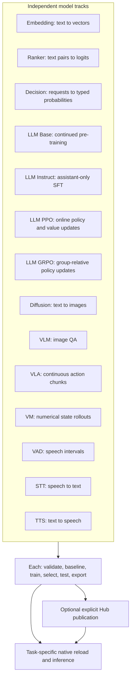
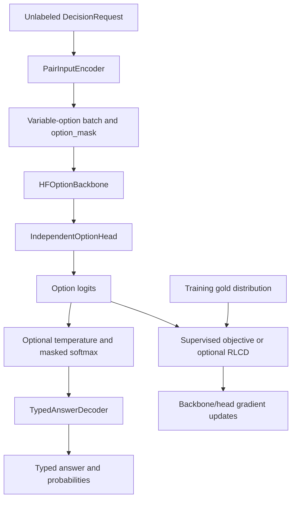

# Architecture: independent training tracks and the Decision Model

English | [简体中文](architecture.zh-CN.md)

This project provides fourteen independent training/inference tracks: Embedding,
Ranker, Decision, LLM Base, LLM Instruct, LLM PPO, LLM GRPO, Diffusion, VLM, VLA
VM, VAD, STT and TTS. Each owns its task-specific configuration, data validation, sampling,
objective, evaluation, model composition, export and CLI. Applications can deploy
them separately or explicitly combine their outputs.

VLM implements native LLaVA single-image QA; VLA implements CLIP/state continuous
action behavior cloning; VM means World Model and implements numerical dynamics.
See their [VLM](vlm.md), [VLA](vla.md) and [VM](vm.md) contracts and section 11.

Decision is a project-owned model. Laya is a conceptual reference for explicit
questions/options, typed probabilities and calibration, not an installation/runtime
dependency. This project implements its encoding, composition, head, loss, rewards,
training, calibration, decoding and export. It reuses a configurable pretrained
HF text encoder and trains the decision head from random initialization. Domain
decision quality must be established with domain data.

## 1. Independent models, explicit application composition

The tracks are peers, not stages that must run in sequence or train simultaneously.
Each can choose its own base, parameters, device and deployment.



Dependency direction is task → `common`; tasks do not import one another. The four
LLM tasks also reuse neutral SDK, runtime, config and file tools under `llm/`.
Objectives, metrics, selection and training assembly remain task-owned.

- Embedding/Ranker share a neutral retrieval optimizer loop.
- Decision owns its training loop.
- Base/Instruct separately assemble Transformers Trainer.
- Their [MoE architecture extension](llm-moe.md) shares only native sparse loading,
  adapter targeting and diagnostics; CPT/SFT supervision and Trainer assembly remain task-owned.
- PPO/GRPO own online RL loops; Diffusion owns its denoising loop.
- VLM/VLA/VM inject models, data, loss, evaluation and persistence into a neutral epoch executor.
- STT/TTS use the same neutral executor, with independent audio preparation and objectives.
  They use a separate speech environment; see [STT](stt.md) and [TTS](tts.md).
- VAD uses that executor for decoder-only adaptation, then fits its offline threshold policy
  on validation intervals. It does not depend on Transformers; see [VAD](vad.md).

Different trainers do not imply upstream/downstream model dependencies. A Base
full/merged export can initialize Instruct, and an SFT full/merged export can
initialize PPO/GRPO. These are optional file-level handoffs, not module imports.

| Optional layer | Capabilities used | Relationship |
| --- | --- | --- |
| `data_preparation` | Embedding mining, labeled/manual/keyword candidates | Produces standard training inputs; trainers do not implicitly mine |
| `workflows` | Embedding retrieval + Ranker reranking | Explicit inference composition for retrieval evaluation |
| Domain application | Outputs from any model | May construct Decision state or use Decision independently; the retrieval workflow does not implement this step |

### 1.1 Lifecycle and interface goals

The design goal is consistent engineering entry points, responsibilities and
experiment stages while retaining task-specific requests, batches, losses, metrics
and outputs. The implementation is not yet completely uniform.

```text
task config + data
        ↓
load model → evaluate baseline → train → select on validation
        ↓
optional fitted postprocessing → evaluate test → export
        ↓
task Model.load → task inference method → task result
or: export → explicit publish → pinned Hub snapshot → task Model.load
```

Decision can fit temperatures; VAD can calibrate offline thresholds; Embedding/Ranker have no fitted
postprocessing. Merged adapter export is serialization, not fitted postprocessing.
The proposed generic contracts are:

```text
Model.load(path, device) -> task model facade
Model.save(path) -> export path
Model.predict(requests, batch_size) -> task results
Evaluator.evaluate(...) -> EvaluationResult(metrics, predictions, metadata)
Pipeline.run(config, resume) -> ExperimentReport
```

These are **design goals**, not an existing global `Model` or `EvaluationResult`
class. Suggested report fields are `task`, `data`, `training`, `baseline`, `selected`,
`postprocessed`, `export_dir`, `runtime`, with null for inapplicable postprocessing.
Actual `run(cfg)`/`run_experiment(config_path)` signatures and report fields still
differ. Task methods such as `encode`, `score`, `system_one`, `generate` and `chat`
retain their meaningful output semantics. Ranker logits are not calibrated probabilities.

Requests, results and export manifests should carry task identity/schema versions.
An outer manifest must not force native SDK weights into a new internal format.
Each task's `model.py` owns backend adaptation without a separate provider layer
or shared encoder weights between tasks.

## 2. Layout and responsibility boundaries

```text
configs/
  embedding/ ranker/ decision/ diffusion/ vad/ stt/ tts/
  llm/{base,instruct,ppo,grpo}/ vlm/ vla/ vm/
  data_preparation/ workflows/       # Optional preparation/composition
src/advai_notebooks/
  common/                           # Runtime, atomic artifacts, provenance, checkpoints
    hub.py                          # Neutral packaging/upload/snapshot transport
    retrieval_training.py           # Injected retrieval optimization loop
    native_training.py              # Injected multimodal/speech epoch lifecycle
    audio.py                        # Neutral local PCM/resampling/fingerprint tools
    native_publication.py           # Injected inference-file whitelist packaging
  embedding/ ranker/                # Task-specific model/data/loss/metrics/CLI
  decision/
    contracts.py schema.py          # Requests, component interfaces, task/label validation
    data.py encoding.py             # Records, requests, state/question/option pairs
    backbones.py heads.py model.py   # HF encoder, independent option head, model facade
    runtime.py sampling.py           # Variable-option batches and sampling
    losses.py optimizer.py train.py  # Objectives, parameter groups, epoch recovery
    metrics.py evaluate.py           # Metrics and prediction/evaluation orchestration
    calibrate.py decoding.py         # Temperature fitting and typed answers
    inference.py                     # Legacy functional inference compatibility
    config.py pipeline.py cli.py publish.py
  llm/
    configuration.py native.py runtime.py records.py
    rollout.py rl_runtime.py         # Neutral sampling/checkpoint mechanics
    base/ instruct/ ppo/ grpo/       # Independent task modules
  diffusion/                        # Native pipeline plus task-owned denoising lifecycle
  vlm/ vla/ vm/                     # Independent multimodal/dynamics baselines
  vad/ stt/ tts/                    # Independent Silero / Whisper / Qwen3-TTS adaptation
  data_preparation/ workflows/       # Optional composition layer
notebooks/                          # Tutorials calling the same Python implementation
tests/                              # Components, lifecycle and import isolation
```

### 2.1 Current entry points

Paths below are relative to each task directory, including `llm/<task>/`.

| Responsibility | Current convention | Task-specific differences |
| --- | --- | --- |
| Configuration | `config.py` | Retrieval config bases differ from Decision and multimodal dataclasses |
| Model facade/composition/load/save | `model.py` | Native SDK layouts and public inference methods remain distinct |
| Network components | `backbones.py`, `heads.py` in the original eight tasks | VLM/VLA/VM compose their smaller components directly in `model.py` |
| Records/input handling | `data.py` plus model preparation | Prefixes, pairs, assistant masks, media and numerical semantics differ |
| Sampling/objective/optimizer | `sampling.py`, `losses.py`, `optimizer.py` in the original eight tasks | PPO/GRPO additionally own `reward.py`; new baselines inject task loss/data into the neutral executor |
| Training/lifecycle/CLI | `train.py`, `pipeline.py`, `cli.py` in the original eight tasks | VLM/VLA/VM use task pipelines with neutral epoch execution |
| Metrics/evaluation | `metrics.py`, `evaluate.py` in the original eight tasks | VLM/VLA/VM calculate metrics in their own `evaluate.py` |
| Optional fitted postprocessing | Decision `calibrate.py` | Other current tracks have no fitting step |
| Publication | `publish.py` | Task-owned file contracts/cards with neutral transport |

Decision's `from_config/load/save`, input preparation and `system_one` are fully
implemented in `model.py`, without provider/Bundle wrappers. `data.py` exposes
request types and task/record validation. `evaluate.py` provides `evaluate`,
`fit_postprocess`, `evaluate_selected`; pipelines orchestrate and save artifacts.
`inference.py` and old predict methods retain compatibility by delegating to
`system_one`. `DecisionModel` is also a native PyTorch module; `.model` exposes
its training module. Direct backbone/head construction supports network experiments,
but complete input/export/inference needs tokenizer/metadata binding via config or load.

#### Network component boundaries

| Task | Backbone | Head/output |
| --- | --- | --- |
| Embedding | Existing SentenceTransformer Transformer/HF encoder view | Original pooling/Dense/Normalize sequence → normalized vector |
| Ranker | Existing CrossEncoder encoder view | Native classifier-side modules → one raw relevance logit |
| Decision | HF encoder and option-level pooling | Type embedding + independent scoring MLP → option logits |
| Base/Instruct | Native causal decoder view | Native vocabulary projection → token logits |
| PPO | Native causal decoder | Native LM head + linear value head |
| GRPO | Native causal decoder | Native LM head, no critic |
| Diffusion | Native UNet/VAE/text encoder | View of the native UNet output layer |

Embedding views reference existing native modules in their original order;
MNRL/Cached MNRL use the same SentenceTransformer parameters. Pooling/Normalize
may be parameter-free; existing Dense layers remain intact. Ranker scoring still
runs the architecture's complete native classification forward, preserving BERT
pooler/dropout/classifier ordering and RoBERTa-style head behavior. It does not
rewrite arbitrary HF classifiers into a universal independent-head forward.

Views do not register duplicate parameters: native SDK models own their weights
and naming. Base/Instruct similarly retain native causal attention and tied weights.
Decision owns its PyTorch components. File-level responsibilities are consistent;
inheritance, call signatures, tensor shapes and registration remain task-specific.
New learnable components also need configuration and export/reload support.

### 2.2 Proposed extension skeleton, not a completed migration

```text
task/
  config.py contracts.py           # Neutral fields plus task requests/results
  data.py encoding.py              # Validation and input preparation
  model.py                         # Composition, initialization, load/save, public inference
  backbones.py heads.py             # Task-local components or native views
  sampling.py losses.py optimizer.py train.py
  metrics.py evaluate.py           # Formula ownership separate from orchestration
  postprocess.py                   # Optional fitted stage, only when needed
  pipeline.py cli.py               # Consistent lifecycle stages and commands
  inference.py                     # Optional internal/compatibility implementation
```

This is a responsibility convention, not a claim that every file exists. Keep
useful internal files such as Decision schema/decoding/calibration. Do not create
empty identity modules or an unnecessary learnable Embedding classification head.
Loading/saving belongs in `model.py`, not a provider directory.

Neutral config validation must not impose corpus/qrels/query-prefix requirements
on Decision. Current `common/configuration.py` retrieval assumptions need separating
before a global config migration. Task optimizers can retain encoder/head learning
rates. Align lifecycle/checkpoint behavior before extracting more loops; variable
options and calibration do not require immediate merger of trainer internals.

Suggested migration order: define neutral model/evaluation/report contracts; align
facades/reports while retaining old methods; migrate callers to task-local ownership;
then align lifecycle/manifests and extract worthwhile repetition. At each step,
test native reload, numerical equality, import isolation and recovery. Source
changes invalidate strict old training-state resume; compatible inference exports
must remain readable. Public Decision boundaries are aligned, but global types,
configuration and reports remain future work.

### 2.3 Metrics: task-owned formulas, consistent records

Each original task's `metrics.py` owns formulas, record construction/validation,
selection and improvement comparison. Tasks do not import one another's metrics;
`common` does not calculate them. Embedding evaluates complete-corpus retrieval;
Ranker evaluates provided candidates. Both independently implement Recall/MRR/nDCG.
Recall denominators and nDCG ideal rankings use all known qrels; missing positives
are never inserted. Decision owns NLL/Brier/ECE/accuracy/expected-level error.
`evaluate.py` orchestrates predictions/groups; calibration fits temperatures separately.
Data preparation validates candidates but does not compute metrics. Workflows call
Embedding metrics for retrieval and Ranker metrics for reranking.

Embedding, Ranker, Decision, Base/Instruct and Diffusion provide `task`,
`metric_schema_version: 1` and `metric_records`, for example:

```json
{
  "name": "recall@10",
  "value": 0.75,
  "n": 2,
  "group": {"scope": "overall"},
  "direction": "maximize"
}
```

The example is a format illustration, not a benchmark. Records contain name,
finite value, counted population, group and optimization direction. Group scopes
include overall/query/question/type; non-overall groups carry an `id`.

- Ranking overall `n` counts queries; per-query `n` is one.
- Decision `n` counts decisions; `normalized_score_mae` counts only score decisions.
- Recall/MRR/nDCG/accuracy maximize; NLL/Brier/ECE/level errors minimize.
- Diffusion `denoising_mse` minimizes; `n` counts images, not noise draws.

Units/populations remain task-specific. Direction does not automatically make a
metric configurable for selection. Task-local `select_metric` selects exactly one
overall record; missing/duplicate/nonfinite values fail. `is_improvement` applies
the explicit direction. Retrieval passes these callbacks to the neutral loop and
checkpoints the direction; changing direction during training fails. Equal values
retain the existing best model for retrieval/Decision (RL tie behavior differs).
Legacy ranking `metrics/per_query/n_queries` and Decision `overall/by_question/by_type`
remain available with unchanged denominators/formulas. PPO/GRPO currently return
task identity, split, metrics and predictions without this record type; full
`EvaluationResult/ExperimentReport` unification is still a design goal.

## 3. Decision inputs and components

### 3.1 Unlabeled requests

The public input is `DecisionRequest(state, question, options, kind)`:

- `state`: nonempty text, JSON object or list; structured values must be finite and serializable.
- `question`: nonempty question/instruction.
- `options`: at least two `DecisionOption(key, description)` values with unique keys.
- `kind`: `choice`, `score` or `noul`, mapped internally to 0, 1 and 2.

Choice keys are domain labels. Score keys are ordered `"0"…"K-1"`, with descriptions
explaining equally spaced zero-based integer levels. Noul options are fixed
`false, true`. `DecisionRequest.from_question` converts task JSON to this input.
Import public request types from `data.py`; `contracts.py`/`schema.py` own internal
definitions/validation. Training additionally supplies `gold`; inference requests
need no task file, task ID or labels.



Let B be decisions, K the batch's maximum option count, L token length and H
backbone feature width. Component interfaces live in `contracts.py`:

| Interface | Input | Output/responsibility |
| --- | --- | --- |
| `InputEncoder` | Request | `EncodedDecision(options, truncated)`, complete per-option features |
| `OptionBackbone` | Tokens/attention `[B,K,L]`, mask `[B,K]`, optional token types | Pooled `[B,K,H]`, exposes `output_size=H` |
| `DecisionHead` | Features `[B,K,H]`, mask `[B,K]`, qtype `[B]` | Logits `[B,K]` |
| `DecisionObjective` | Logits/gold/mask `[B,K]`, qtype `[B]`, optional sigma | Example-mean scalar loss |
| `AnswerDecoder` | Request, calibrated probabilities, optional confidence threshold | Typed answer dictionary |

Custom PyTorch backbones/heads can be injected for experiments. Config factories
currently support only `encoding: pair`, `head: independent`, `decoder: typed`;
unknown names fail. New components need factory/config extensions and shape/mask/
gradient/export tests. Save/load persists supported HF backbones/independent heads,
not arbitrary injected components automatically.

### 3.2 Encoding and baseline architecture

`PairInputEncoder` separately pairs the same state with every complete option segment:

```text
segment A: state text or stable JSON
segment B: type + question + option key + criteria description
```

Fast-tokenizer postprocessing preserves architecture-specific special tokens.
`head_max_len` bounds the question/option segment; `max_len` bounds the complete
pair including special tokens. All options see the same state prefix, sized for
the longest segment. Oversized question/options and token-identical options fail.
Training rejects state truncation by default; explicitly allowed truncation is
counted. Public inference rejects truncation.

The backbone encodes only valid options with mean/CLS pooling. The head adds a
question-type embedding and applies shared `LayerNorm → Linear → GELU → Dropout → Linear`
to produce a scalar. There is no option-position embedding: reordering choice
options preserves keyed probabilities, while score order still defines levels.
Padding bypasses the encoder and is masked before loss/softmax.

Each option is scored independently: its raw logit does not read other options'
representations. Relative comparison occurs only in the softmax denominator.
Encoder cost grows with valid option count. Cross-option attention/shared-state
encoding/interactive heads are not implemented.

Bases must be bidirectional text encoders with `hidden_size`, fast tokenizers and
pad tokens. Decoder-only/seq2seq models are rejected. Pooling, head width/dropout,
encoder freezing and separate encoder/head learning rates are configurable.

## 4. Decision objectives and experiment scope

Default `training.loss: supervised` supports hard labels and soft distributions y.
For valid-option probabilities p:

```text
CE = -Σ_i y_i log(p_i)
Ordinal = Σ_{j=0}^{K-2} (CDF_p(j) - CDF_y(j))² / (K-1)
L_supervised = mean_examples(ce_weight × CE + ordinal_weight × 1[kind=score] × Ordinal)
```

Choice uses multiclass CE; noul uses false/true CE. Score adds normalized ranked
probability score, penalizing probability errors across distant levels. The final
CDF and padding are excluded. Loss averages all decisions, with zero ordinal term
for non-score examples, preserving accumulation weighting across microbatches.
Defaults are `ce_weight=1`, `ordinal_weight=1`.

| Mode | Objective | Configuration/purpose |
| --- | --- | --- |
| `ce` | `ce_weight × CE` only | `ce_smoke.yaml`, ordinal-loss ablation |
| `supervised` | CE + score ordinal term | `smoke.yaml` / `hf.yaml`, default baseline |
| `rlcd` | Supervised + `rl_weight × RL` | `rlcd_smoke.yaml`, optional experiment |

RLCD samples centered Gaussian noise on logits, rewards choice/noul with negative
Brier and score with negative ordinal error, and updates through sampling-policy
log density and detached advantages. Configure `noise_samples`, `sigma_start/end`
and `rl_weight`. Set `ordinal_weight=0` for the older CE + RLCD combination.
This borrows probability-reward ideas, not Laya encoder/collator/reward implementations.
Synthetic smoke results do not show RLCD outperforming supervision.

Compare objectives with fixed base/revision, data/splits, descriptions, token and
training budgets, freezing, seed and calibration, using separate output directories.
Real experiments need multiple seeds, latency/memory and per-type results, not a
single aggregate accuracy comparison.

## 5. Data, evaluation and calibration

Retrieval task configs validate independently. Ranker has no retriever/contrastive
loss settings; Embedding retrieval config evaluates only its own encoder. Mining
lives in `data_preparation`; combined top-k evaluation lives in `workflows`.
Prepared JSON contains schema, data fingerprints, rows and optional provenance;
JSONL is also supported. Trainers still validate source/split, labels and candidate
identity. Tasks may use different corpora/query/qrels; combined evaluation must
explicitly choose one common test benchmark.

Decision JSONL contains `id/group_id/split/task/state/gold`. Task JSON supports the
three types and partially labeled questions. Positive-mass soft labels normalize;
unknown options, negative/nonfinite values or zero mass fail. Groups and identical
states cannot cross splits. Real data also needs source/time/semantic near-duplicate grouping.

Lifecycle: baseline → train/validation selection → independent calibration fitting →
test comparison → export. Epoch zero participates by default. Selection minimizes
uncalibrated validation NLL/Brier/ECE or maximizes accuracy. Calibration needs
train/validation/calibration/test; disabled calibration needs only three splits.
Test selects neither weights nor temperatures.

Temperature fitting minimizes bounded calibration NLL. Underrepresented types use
temperature one; sparse option-count buckets fall back to type temperature.
Identity is a candidate, ensuring calibration NLL does not regress; test metrics
can still worsen. Disabled calibration exports identity and reports null calibrated metrics.
Reports include overall/per-question/per-type accuracy/NLL/Brier/ECE and normalized
expected-level MAE for score. Domain subgroups, imbalance, option counts, abstention
coverage/error and source/time shifts need further evaluation. Tiny BERT/synthetic
data verify mechanics only; real benchmarks, interactive heads, LoRA and multi-GPU
are not implemented or validated for Decision.

## 6. Inference artifacts

Embedding uses `EmbeddingModel.load/encode`; Ranker uses `RankerModel.load/score`,
preserving native SDK structures and legacy exports. Local/Hub loading supports
`revision`, `token`, `cache_dir`, `local_files_only`; snapshots then use task loaders.
`publish --export-dir ... --repo-id ... --dry-run` validates inference packages offline;
real publication returns a commit SHA. Training does not upload. Publication excludes
data/optimizer state. See the [publication guide](publishing.md).

Decision native export:

```text
export/
  decision_config.json            # Schema v2, components, budgets, head and temperatures
  model.safetensors               # Complete backbone/head weights
  encoder/config.json             # Base architecture reconstruction
  tokenizer/                     # Matching tokenization
  source.json                    # Base provenance/revision
  tasks.json                     # Definitions for system_one(state, task=...)
  calibration.json               # Calibration metadata
```

Loading rebuilds from local config and strictly loads weights without downloading
the pretrained base. `system_one` handles encoding, forward, temperature/softmax
and decoding; inference batches contain no targets.

```python
from advai_notebooks.decision.model import DecisionModel

model = DecisionModel.load("outputs/decision/smoke/export", device="cpu")
result = model.system_one("charged twice refund today", task="triage")
# result["answers"][question_id] is that question's typed answer.
```

State mode returns `{"answers": {question_id: answer}}` using bundled definitions.
`from_config` binds tasks; save writes and load reads `tasks.json`. Explicit `tasks=...`
can override them. Missing definitions/unknown tasks fail. Old exports without
tasks can use explicit definitions or direct requests:

```python
from advai_notebooks.decision.data import DecisionOption, DecisionRequest

request = DecisionRequest(
    state="charged twice refund today",
    question="Which department should handle this ticket?",
    options=(DecisionOption("billing", "Payment or refund"),
             DecisionOption("technical", "Service outage or bug")),
    kind="choice",
)
answer = model.system_one([request])[0]
```

Request-list mode returns ordered answers. All kinds expose keyed `probabilities`
and `confidence=max(p)` (also the legacy `answer_confidence` field):

| Kind | Main fields | Meaning |
| --- | --- | --- |
| `choice` | `choice`, probabilities, confidence | Maximum-probability option key |
| `score` | `score`, probabilities, confidence, `level`, `legend` | Expected zero-based level in 0…K−1; `level` is argmax |
| `noul` | `noul`, probabilities, confidence | `noul=P(true)`, in 0…1 |

Noul confidence may correspond to false; it is not necessarily P(true).
`min_confidence` adds an `abstained` flag; applications decide whether to act.
New tasks/descriptions do not automatically confer new domain ability.
Old `predict/predict_requests/predict_state` and functional inference remain aliases
of the same path. Native v1 independent-head exports support parameter-name migration
and resave to schema v2 without changing probabilities. Earlier Laya SDK exports
have a different architecture and require retraining. Inference compatibility does
not imply cross-implementation training-state compatibility.

## 7. Retrieval/Decision checkpoints and validation boundaries

`latest/training_state.pt` atomically saves completed-epoch current/best weights,
optimizer/scaler and Python/NumPy/Torch/device RNG. Resume reconstructs the optimizer
and restores state before the next batch; incomplete epochs replay from the previous
boundary. Atomic state can repair interrupted best/latest inference writes.
Retrieval reconstructs from stable baseline metadata; Decision uses native config/weights.

`run --resume` must target the original `output_dir/latest`, with unchanged config,
planned epochs, input content, package versions, device and relevant source.
Changed objectives/components require a new run. `common/provenance.py` follows
task/internal static imports: unrelated retrieval changes do not invalidate Decision
resume, while relevant shared runtime/checkpoint changes do.

CPU tests cover metric records/populations/groups, bidirectional selection, tiny
training, native reload, CLI, padding/order invariance, ordinal loss, component
replacement, unlabeled inference, calibration and exact dropout-enabled recovery.
Separate processes block other tasks and Laya/Sentence Transformers during Decision
training/inference to check isolation. Retrieval tests similarly block the other
task and cover MNRL/Cached MNRL/BCE, leakage, candidate identity and composition.
CUDA/MPS recovery and mixed precision require target-hardware checks.

## 8. LLM Base and Instruct

Native decoder/LM-head views retain causal attention and weight tying. Base data
owns document grouping/EOS/boundary-preserving slices; Instruct owns conversations,
templates, assistant masks and truncation checks. Each assembles Trainer, sampling,
loss, optimizer, selection and callbacks independently. Metrics are token-weighted
NLL/PPL; Instruct can add exact match/JSON validity. See the [LLM guide](llm.md).

Neutral `llm/native.py` provides HF/PEFT initialization, serialization, generation
and positional padding. Configuration/runtime/records modules own shared mechanical
validation, Trainer arguments, signatures and JSONL/group integrity, not task metrics.
Native Trainer checkpoints retain optimizer/scheduler/RNG with `advai_resume.json`
and facade files. `latest.json` supports the logical `output_dir/latest` alias.
This differs from section 7's state format; inference exports cannot resume.

Full/LoRA are implemented for one device. Hub adapter bases pin revisions; local/tiny
bases bundle frozen snapshots. Merging reloads a copy. QLoRA, packing, distributed
training and preference training remain unsupported. CPU fp32 checks do not validate
CUDA/MPS, AMP or real-domain quality.

## 9. LLM PPO and GRPO

Independent online RL tracks, not Instruct SFT. PPO combines a causal LM and shared-
decoder linear value head with token GAE and clipped policy/value objectives.
GRPO has no critic; it samples groups, normalizes rewards and applies clipping/KL.
Each owns rule/custom scalar rewards and metrics and maximizes validation reward;
test is held out. Shared rollout/runtime modules contain sampling/checkpoint/RNG
mechanics only. See the [RL guide](rl.md).

`export/` is validation-selected; `latest_export/` is the final trained actor.
Complete checkpoints include policy, frozen reference, PPO value head, optimizer,
RNG and signatures. Full/merged actors load natively; adapters use PEFT. The first
version supports single-device fp32, full/LoRA and accumulation, explicitly rejecting
mixed precision, distributed launches and gradient checkpointing.

## 10. Diffusion

The first backend uses native StableDiffusionPipeline with one CLIP text encoder,
VAE and UNet. Heads reference the existing UNet output layer. Noise schedulers are
distinct from learning-rate schedules. Sampling owns batches/noise/timesteps;
losses use per-image epsilon/velocity MSE. Full trains the UNet; LoRA trains UNet
adapters, with VAE/text encoder frozen. Fixed per-image evaluation draws and VAE
mode provide deterministic validation. Selection minimizes denoising MSE including
epoch zero; test is report-only. There is no FID/CLIP-score or fitted postprocessing.

Full exports save the native pipeline; LoRA bundles a frozen base. Merge operates
on a copy. Publication excludes source images, generations and training state.
Atomic complete-epoch checkpoints retain optimizer/RNG/signatures and latest pointers.
CPU fp32 full/LoRA and exact recovery are checked; real models/CUDA/MPS need target
validation. AMP, multi-GPU, SDXL/DiT/video, img2img and inpainting are unsupported.
See the [Diffusion guide](diffusion.md).

## 11. VLM, VLA and VM baselines

| Task | Model/inference | Local data/objective/evaluation |
| --- | --- | --- |
| VLM | Native LLaVA + processor, full/language LoRA, `chat` | Single-image QA, assistant-only labels, token-weighted NLL/PPL |
| VLA | CLIP image/text + state + action MLP, `predict` | Episode-contained chunks/tail masks, original-unit action MSE/MAE |
| VM | Action-conditioned residual MLP, `predict/rollout` | Numerical future windows, recursive loss, one-step/rollout MSE |

Each owns config/data/model/loss/evaluate/pipeline/CLI/publication without imports
from the others or text LLM tasks. Smaller components live in `model.py`; metrics
live in task-local `evaluate.py`. `common/task_configuration.py` supplies neutral
dataclass/YAML mechanics; `common/media.py` handles local RGB, records/groups and
numeric validation. `common/native_training.py` executes injected objectives with
supervision-count-weighted accumulation, strict epoch recovery and baseline/
validation/test stages. VLA/VM normalization/physical semantics stay task-owned.

`latest/state.json` atomically points to the latest complete checkpoint containing
native model, optimizer, RNG and provenance. `export/` selects validation best
including epoch zero; `latest_export/` is final. VLM LoRA bundles its base; VLA saves
complete CLIP/processor, action head, statistics and action semantics; VM saves
dynamics safetensors plus architecture/statistics/state semantics without raw trajectories.
Neutral publication whitelist mechanics reload packages before transport and exclude
raw data/media, optimizer and logs.

All three first backends are single-process, single-device fp32. Tiny CPU/synthetic
fixtures verify interfaces, not quality. VLM has no video/Qwen-VL backend; VLA is
not an OpenVLA adapter; VM is not a video world model.
